  <!-- Header animasi: file di repo -> assets/header.svg -->
  

  <!-- Teks mengetik -->
  

  

    
    
    
  

<h2 align="center">👨‍💻 Tentang Saya</h2>

  Junior Web &amp; Mobile Developer yang senang membangun aplikasi yang fungsional, terstruktur, dan mudah digunakan, 
  mulai dari perancangan alur sistem sampai implementasi kode.

<table align="center" width="100%">
  <tr>
    <td width="25%"><b>🔭 Fokus</b></td>
    <td>Aplikasi web full-stack dengan <b>Laravel</b> dan aplikasi mobile lintas platform dengan <b>Flutter</b></td>
  </tr>
  <tr>
    <td><b>📐 Perancangan</b></td>
    <td>Flowchart, use case diagram, dan skema basis data relasional</td>
  </tr>
  <tr>
    <td><b>💡 Prinsip Kerja</b></td>
    <td>Alur pengguna yang jelas, struktur kode rapi, dan solusi praktis</td>
  </tr>
  <tr>
    <td><b>🌱 Sedang Dipelajari</b></td>
    <td>REST API, arsitektur MVC yang lebih dalam, optimasi query, dan deployment</td>
  </tr>
  <tr>
    <td><b>🤝 Terbuka Untuk</b></td>
    <td>Kolaborasi proyek, magang, dan kesempatan kerja di bidang software development</td>
  </tr>
</table>

  <b>Alur kerja saya</b> 
  📝 Analisis &nbsp;→&nbsp; 📐 Flowchart &amp; Use Case &nbsp;→&nbsp; 🗄️ Desain Database &nbsp;→&nbsp; 💻 Coding &nbsp;→&nbsp; 🧪 Testing &nbsp;→&nbsp; 🚀 Deploy

<h2 align="center">🛠️ Tech Stack &amp; Tools</h2>

  <b>Bahasa Pemrograman</b>  
  

   

  <b>Framework &amp; Library</b>  
  

   

  <b>Database &amp; Tools</b>  
  

 

<h2 align="center">🚀 Proyek Pilihan</h2>

<table align="center" width="100%">
  <tr>
    <td width="50%" valign="top">
      <h3>🎟️ <a href="https://github.com/JastinSimorangkir-77/Evontra">Evontra</a></h3>
      
Platform manajemen dan pemesanan tiket event berbasis web: katalog event, pendaftaran penyelenggara, dan e-ticket QR Code.

      
      
      
    </td>
    <td width="50%" valign="top">
      <h3>✅ <a href="https://github.com/JastinSimorangkir-77/TugasKu">TugasKu</a></h3>
      
Aplikasi mobile untuk mencatat, mengelompokkan, dan mengingatkan tugas serta tenggat waktu secara terorganisir.

      
      
    </td>
  </tr>
  <tr>
    <td width="50%" valign="top">
      <h3>🛒 <a href="https://github.com/JastinSimorangkir-77/Sembakoci">Sembakoci</a></h3>
      
Aplikasi katalog dan pemesanan warung sembako online untuk mempermudah akses kebutuhan harian.

      
    </td>
    <td width="50%" valign="top">
      <h3>🏥 <a href="https://github.com/JastinSimorangkir-77/HealthCivic">HealthCivic</a></h3>
      
Portal informasi dan layanan kesehatan masyarakat berbasis web.

      
      
      
    </td>
  </tr>
</table>

<!-- CATATAN: samakan nama repo pada tautan proyek dengan nama repository aslimu agar tidak 404. -->

<h2 align="center">📊 Aktivitas GitHub</h2>

  

    

  <!-- Animasi ular: muncul setelah workflow "Generate Snake Animation" dijalankan (tab Actions) -->
  <picture>
    <source media="(prefers-color-scheme: dark)" srcset="https://raw.githubusercontent.com/JastinSimorangkir-77/JastinSimorangkir-77/output/github-snake-dark.svg" />
    <source media="(prefers-color-scheme: light)" srcset="https://raw.githubusercontent.com/JastinSimorangkir-77/JastinSimorangkir-77/output/github-snake.svg" />
    
  </picture>

 

<h2 align="center">🎯 Target Belajar 2026</h2>

  ✅ Membangun aplikasi web full-stack dengan Laravel 
  ✅ Membuat aplikasi mobile pertama dengan Flutter 
  ⬜ Menguasai REST API (membuat dan mengonsumsi) 
  ⬜ Menulis unit test &amp; feature test di Laravel 
  ⬜ Deploy aplikasi ke server/hosting sungguhan 
  ⬜ Berkontribusi pada proyek open source

<h2 align="center">📫 Kontak &amp; Kolaborasi</h2>

  Terbuka untuk diskusi proyek, kolaborasi, serta kesempatan <b>kerja/magang</b>. 
  Jangan ragu untuk menyapa!

  
  
  

  <i>"Make it work, make it right, make it fast."</i> ✨

<!-- Footer animasi: file di repo -> assets/footer.svg -->

